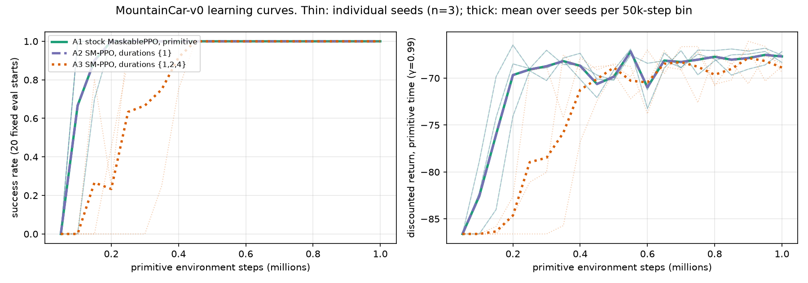

# SemiMarkovPPO (`semi-markov-ppo`)

A PyTorch implementation of Semi-Markov Proximal Policy Optimization (PPO). It extends
[sb3-contrib](https://github.com/Stable-Baselines-Team/stable-baselines3-contrib)'s `MaskablePPO` (Stable-Baselines3
ecosystem) with variable-duration actions, transition-specific discounting and variable-duration GAE. Package name:
`smppo`.

> Version 0.1.0. Licensed under the [MIT License](LICENSE).


*One evaluation episode on `MountainCar-v0` (start seed 10000), using the seed-0 models from the benchmark below.
Left: stock MaskablePPO, one primitive action per decision. Right: SemiMarkovMaskablePPO choosing left/coast/right
held for 1, 2 or 4 steps. Both panels advance one primitive step per frame. In this episode both reach the goal (110
and 107 steps) and the Semi-Markov agent makes 77 decisions against 110. This is a single episode; see the benchmark
table for results over 100 starts and 3 seeds. Generated by `examples/mountaincar/make_gif.py`.*

## The problem

In many control problems one decision does not take one fixed unit of time:

* a vessel sails to the next waypoint at a chosen speed;
* a robot executes a skill until it finishes;
* an agent holds an action for 1, 2 or 4 steps.

If decision t lasts k_t primitive steps (or Δt_t units of time), the return of the underlying process discounts the
next decision by γ^{k_t}. The PPO implementations in Stable-Baselines3, sb3-contrib and CleanRL apply one scalar γ per
decision in GAE (see [docs/prior_art.md](docs/prior_art.md)). Fed variable-duration
transitions, they discount a 4-step action exactly like a 1-step action. The value targets and advantages then belong
to a different objective from the one the environment defines.

## What this package does

`SemiMarkovMaskablePPO` keeps PPO's policy update unchanged and changes only how a rollout is turned into advantages.
For each transition the environment reports, in `info`:

* `gamma_t`: the transition's discount;
* `truncated_cutoff`: whether the episode was cut off externally (a time limit) rather than terminated.

Notation for decision t: reward R_t, duration k_t, end flag e_t (1 on termination or truncation).

**Reward accumulated within a temporally extended action** (computed by the environment or by `MacroActionWrapper`):

$$R_t = \sum_{j=0}^{k_t-1} \gamma^{j}\, r_{t,j}$$

**Transition-specific discount:**

$$\gamma_t = \gamma^{k_t} \qquad\text{or, for continuous durations,}\qquad \gamma_t = \gamma^{\Delta t_t / \Delta t_0}$$

**Variable-duration GAE:**

$$\delta_t = R_t + \gamma_t (1-e_t)\, V(s_{t+1}) - V(s_t), \qquad A_t = \delta_t + \gamma_t\, \lambda\, (1-e_t)\, A_{t+1}, \qquad \hat V_t = A_t + V(s_t)$$

**Termination vs truncation.**
* Termination (goal reached, failure): no future value.
* Truncation (time limit), marked by `truncated_cutoff`: the episode is cut, not finished. The reward is bootstrapped
  exactly once with the real last observation, `R_t ← R_t + γ_t · V(s_terminal)`, and `e_t = 1` so GAE does not
  leak across the reset. SB3's own scalar-γ timeout correction is not applied, so there is no double bootstrap.

**Action masking** is inherited from MaskablePPO. Pass `use_masking=True` (the default) when the environment has
`action_masks()`, or `False` otherwise.

**Duration 1.** With every `gamma_t = γ`, the algorithm reduces to stock MaskablePPO. The test suite checks this
exactly: identical data, advantages, returns, losses, updates and weights (max |difference| = 0.0).

## Relation to Stable-Baselines3 and sb3-contrib

| | SB3 `PPO` / sb3-contrib `MaskablePPO` 2.7.0 | `smppo.SemiMarkovMaskablePPO` |
|---|---|---|
| discount in GAE | one scalar `gamma` for every transition | `info["gamma_t"]` per transition |
| time-limit bootstrap | `gamma * V(terminal_obs)` when `TimeLimit.truncated` | `gamma_t * V(terminal_obs)` when `truncated_cutoff`, once |
| reward of an extended action | whatever the env returns | env (or `MacroActionWrapper`) returns the within-action discounted sum |
| PPO loss, clipping, entropy, value loss, optimiser | — | inherited unchanged |
| action masking | MaskablePPO | inherited unchanged |
| policies, saving and loading, callbacks, VecEnvs | — | inherited unchanged |

All learning machinery comes from Stable-Baselines3 and sb3-contrib. This package replaces the rollout loop and the
advantage computation (one 86-line module, `src/smppo/ppo.py`), and adds two Gymnasium wrappers and tests.

## Installation

```bash
git clone <repository URL>          # not yet published
cd semi-markov-ppo
python -m venv .venv && source .venv/bin/activate
pip install -r requirements.txt     # exact tested versions (CPU torch: add --index-url https://download.pytorch.org/whl/cpu)
pip install -e ".[dev]"
```

Tested with Python 3.12, stable-baselines3 2.7.0, sb3-contrib 2.7.0, gymnasium 1.2.3 and torch 2.7.0 (CPU).
`pyproject.toml` restricts SB3 and sb3-contrib to 2.7.x, because the rollout loop is adapted from sb3-contrib 2.7.0.

## Minimal example

```python
import gymnasium as gym
from stable_baselines3.common.vec_env import DummyVecEnv
from smppo import MacroActionWrapper, SemiMarkovMaskablePPO


# 9 macro-actions: {left, coast, right} x hold for {1, 2, 4} primitive steps.
# gym.make adds TimeLimit(200) INSIDE the wrapper, so the limit counts primitive steps.
def make():
    return MacroActionWrapper(gym.make("MountainCar-v0"), durations=(1, 2, 4), gamma=0.99)


model = SemiMarkovMaskablePPO("MlpPolicy", DummyVecEnv([make] * 8), gamma=0.99, seed=0)
model.learn(200_000, use_masking=False)  # the env has no action_masks()
```

## Defining your own SMDP environment

You have three options.

1. **Repeat primitive actions.** Use `MacroActionWrapper(env, durations, gamma)` on any `Discrete` environment. Action
   `a` decodes to `primitive = a // len(durations)` and `k_max = durations[a % len(durations)]`. Execution stops
   immediately on termination or truncation, so `k` is the duration actually executed. Put any `TimeLimit` inside the
   wrapper.
2. **Transitions that already take variable time.** Use `DurationDiscountWrapper(env, gamma, dt0, ...)`. It reads the
   duration from `info["duration"]`, or computes it with `duration_fn(action, info)`, and adds
   `gamma_t = gamma ** (duration / dt0)`. Your reward must already be the reward of the whole transition.
3. **Your own environment.** Return `info["gamma_t"]` and `info["truncated_cutoff"]` on every step yourself.

The `gamma` passed to `SemiMarkovMaskablePPO` is not used to compute advantages. The discount comes only from
`info["gamma_t"]`. Keep the two consistent for readability.

## Training and evaluation (MountainCar benchmark)

```bash
python examples/mountaincar/train.py --arm A3 --seed 0 --prim_steps 1000000 --out runs/A3_s0
python examples/mountaincar/evaluate.py model --run runs/A3_s0 --arm A3
python examples/mountaincar/evaluate.py summary --runs runs --out results/mountaincar_rerun
```

`train.py` stops on executed primitive steps (`PrimitiveBudget`), not on SB3's decision counter, so arms with
different action durations get the same environment budget.

## Tests

```bash
pytest -q          # 22 tests, about 15 s on one CPU core
ruff check . && ruff format --check .
```

| file | checks |
|---|---|
| `tests/test_parity.py` | duration-1 parity with stock MaskablePPO (data, advantages, returns, losses, one update, weights after `learn()`); seed reproducibility |
| `tests/test_gae.py` | GAE against a hand-written reference (synthetic and real rollouts); reduction to SB3's buffer at constant γ; episode end on the last buffer step |
| `tests/test_discounting.py` | macro sequence replayed against a hand simulation of MountainCar physics; hand-calculated R_t and γ_t; wrapper unit tests |
| `tests/test_truncation.py` | termination and truncation in the middle of a macro-action; bootstrap exactly once from the real terminal observation; masked environment |
| `tests/test_accounting_and_masking.py` | primitive-step accounting; the primitive budget; no accidental masking; masked actions never selected |

The latest measured values are in `results/test_report.json`, and the run log is in `results/test_run.txt`.

## MountainCar benchmark (experimental result, separate from the correctness tests)

Setup:
* Three arms on `MountainCar-v0`, 3 seeds each (0, 1, 2), 1,000,000 primitive steps per run.
* Evaluation on the same 100 fixed starts (reset seeds 10000–10099), with a deterministic policy.
* RL Zoo PPO settings, with reward normalization off in every arm (see [docs/design.md](docs/design.md)).

| arm | success | median primitive steps to goal | discounted return (γ=0.99) | decisions / episode | gradient updates |
|---|---|---|---|---|---|
| A1 stock MaskablePPO, primitive actions | 1.00 (all seeds) | 110.7 ± 0.6 | −67.91 ± 0.41 | 113.9 | 15,624 |
| A2 SemiMarkovMaskablePPO, duration 1 | 1.00 (all seeds) | 110.7 ± 0.6 | −67.91 ± 0.41 | 113.9 | 15,624 |
| A3 SemiMarkovMaskablePPO, durations {1,2,4} | 1.00 (all seeds) | 112.0 ± 1.0 | −68.45 ± 0.53 | 76.7 ± 7.8 | 11,152 ± 299 |

Values are mean ± sd over 3 seeds. With n = 3 the sd describes seed spread; it is not a confidence interval.

* A1 and A2 produced identical evaluation results and learning curves in every seed.
* All A3 seeds reached 100% success. They used about a third fewer decisions per episode and about 29% fewer
  gradient updates for the same primitive-step budget.
* A3 reached full success later in training (about 0.45M against about 0.2M primitive steps). This comparison is
  descriptive only. It mixes the effect of temporal abstraction on exploration with the different number of updates,
  so it does not say whether macro-actions are better or worse in general.



Details, per-seed tables and provenance: [results/mountaincar/README.md](results/mountaincar/README.md).

## Limitations

* **Version pinning.** Built for sb3-contrib/SB3 2.7.x. `collect_rollouts` is a copy of the 2.7.0 loop, so later
  versions may need it re-synchronised.
* **Action spaces.** Those supported by MaskablePPO (`Discrete`, `MultiDiscrete`, `MultiBinary`). Only `Discrete` is
  tested.
* **Required info keys.** `info["gamma_t"]` must be present on every step, or `collect_rollouts` raises `KeyError`.
* **λ is per decision.** It is applied once per decision, not per unit of time. Entropy regularisation (if used) is
  also per decision.
* **Reward normalization.** `VecNormalize(norm_reward=True)` tracks returns with one scalar γ, which is inconsistent
  with per-transition discounts. The benchmark uses observation normalization only.
* **Test coverage.** The suite covers `DummyVecEnv` on CPU. `SubprocVecEnv` uses the same code path but is not
  exercised here.
* **Scope.** Not an options framework: there are no learned termination functions and no intra-option learning.

## Related work and attribution

See [docs/prior_art.md](docs/prior_art.md). The SMDP discounting idea is long established (Bradtke & Duff, NIPS 7;
Sutton, Precup & Singh, Artificial Intelligence 1999), and per-step discounting in GAE also exists elsewhere (for
example, TorchRL accepts a tensor γ). This repository contributes a tested, drop-in SMDP extension of sb3-contrib's
MaskablePPO. It is not presented as a new algorithm.

Code in `src/smppo/ppo.py` is adapted from sb3-contrib 2.7.0 (MIT License, Copyright (c) 2020 Stable-Baselines Team);
see [THIRD_PARTY_NOTICES.md](THIRD_PARTY_NOTICES.md).
