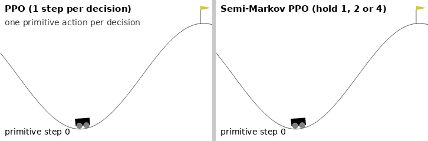
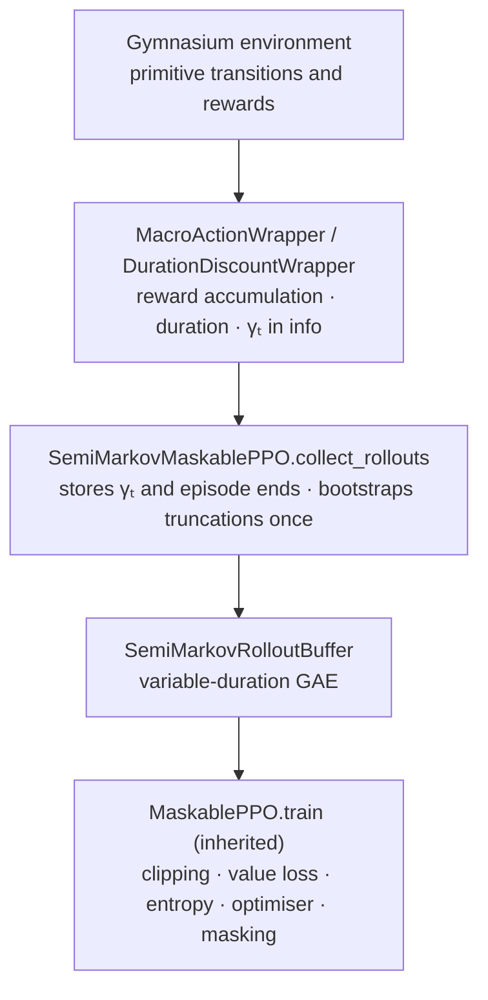

# SemiMarkovPPO

**Semi-Markov Proximal Policy Optimization for Stable-Baselines3.**

SemiMarkovPPO (`smppo`) extends sb3-contrib's `MaskablePPO` to support variable-duration actions. It implements
transition-specific discounting and variable-duration Generalized Advantage Estimation (GAE), and keeps the standard
PPO training objective.

The implementation is built on Stable-Baselines3 and supports Gymnasium environments, vectorized environments and
action masking.



*MountainCar-v0: standard MaskablePPO (left) and SemiMarkovMaskablePPO (right), from the same start (seed 10000),
using the seed-0 benchmark models. The semi-Markov policy selects an action and its duration (1, 2 or 4 primitive
steps). Both episodes reach the goal. In this episode the semi-Markov policy uses 77 decisions against 110 for
standard PPO.*

## Why Semi-Markov PPO?

Standard PPO assumes that each policy decision corresponds to one environment step, so its return and GAE
calculations apply the same discount factor to every transition.

That assumption does not hold when actions have different durations. A vessel choosing its next waypoint and speed
takes different amounts of time to get there. A robot may execute a skill over several control steps before
requesting another action. In these settings, the discount applied to the next decision should depend on the time
the current action took. For an action lasting $k_t$ primitive steps:

$$\gamma_t = \gamma^{k_t}$$

The PPO implementations in Stable-Baselines3, sb3-contrib and CleanRL use one scalar $\gamma$ in GAE.
SemiMarkovPPO uses a transition-specific discount for every rollout sample.

## Implementation

`SemiMarkovMaskablePPO` inherits the policy, loss functions, optimisation and training infrastructure from
`MaskablePPO`. It changes rollout collection and advantage computation.



**Accumulated reward.** For an action lasting $k_t$ primitive steps, the environment returns the discounted sum of
rewards collected while it ran:

$$R_t = \sum_{j=0}^{k_t-1} \gamma^{j} r_{t,j}$$

**Transition-specific discount.** It comes from the duration of each transition. For environments that report
continuous durations, $\gamma_t = \gamma^{\Delta t_t / \Delta t_0}$.

**Variable-duration GAE.** Here $e_t$ is 1 if the episode ended at transition $t$:

$$\delta_t = R_t + \gamma_t (1-e_t)\, V(s_{t+1}) - V(s_t), \qquad A_t = \delta_t + \gamma_t \lambda (1-e_t)\, A_{t+1}, \qquad \hat V_t = A_t + V(s_t)$$

**Termination and truncation.**
* **Termination:** no future value is bootstrapped.
* **Truncation:** an external time limit, flagged by `info["truncated_cutoff"]`. The value of the real final
  observation is added once, $R_t \leftarrow R_t + \gamma_t V(s_T)$, and GAE stops at that transition so nothing
  crosses into the next episode.

The rollout loop replaces sb3-contrib's own scalar-γ timeout correction, so that correction is never applied.

**Action masking** is inherited from `MaskablePPO`. Set `use_masking=True` when the environment provides
`action_masks()`.

**Compatibility with standard PPO.** When every transition has duration one, $\gamma_t = \gamma$ and the
implementation reduces to `MaskablePPO`. The test suite checks this on identical seeds: rollout data, advantages,
returns, losses, parameter updates and final weights. The maximum observed difference is zero.

## Installation

```bash
git clone https://github.com/Vaishnav2804/semi-markov-ppo.git
cd semi-markov-ppo
python -m venv .venv && source .venv/bin/activate
pip install -r requirements.txt     # for CPU-only torch: pip install torch==2.7.0 --index-url https://download.pytorch.org/whl/cpu first
pip install -e ".[dev]"
```

| Dependency | Tested version |
|---|---|
| Python | 3.12 |
| Stable-Baselines3 | 2.7.0 (also 2.7.1) |
| sb3-contrib | 2.7.0 (also 2.7.1) |
| Gymnasium | 1.2.3 |
| PyTorch | 2.7.0 (also 2.15.0) |

SB3 and sb3-contrib are restricted to 2.7.x, because the rollout loop is adapted from sb3-contrib 2.7.0.

## Quick start

MountainCar-v0 with three primitive actions (left, coast, right), each available for 1, 2 or 4 steps:

```python
import gymnasium as gym
from stable_baselines3.common.vec_env import DummyVecEnv

from smppo import MacroActionWrapper, SemiMarkovMaskablePPO


def make_env():
    return MacroActionWrapper(gym.make("MountainCar-v0"), durations=(1, 2, 4), gamma=0.99)


env = DummyVecEnv([make_env for _ in range(8)])
model = SemiMarkovMaskablePPO("MlpPolicy", env, gamma=0.99, seed=0)
model.learn(total_timesteps=200_000, use_masking=False)
```

Each macro-action specifies a primitive action and a maximum duration. Execution stops early if the environment
terminates or truncates.

## Using your own environment

**Repeated primitive actions.** Use `MacroActionWrapper(env, durations, gamma)`. It accumulates the reward and sets
the transition discount. Place any `TimeLimit` inside the wrapper so the limit counts primitive steps.

**Actions that already take variable time.** Use `DurationDiscountWrapper(env, gamma, dt0)`. It reads
`info["duration"]`, or calls a `duration_fn`. The environment must return the reward for the complete transition.

**Custom environments.** Return the two keys on every step:

```python
info = {"gamma_t": gamma_t, "truncated_cutoff": truncated and not terminated}
```

Advantages are computed from `info["gamma_t"]`. The `gamma` argument of the model constructor does not set the
transition discounts.

## Benchmark: MountainCar-v0

Setup:
* Arms: standard `MaskablePPO` (A1), and `SemiMarkovMaskablePPO` with duration 1 (A2) and with durations
  {1, 2, 4} (A3).
* Seeds 0, 1 and 2.
* 1,000,000 primitive environment steps per run, with the budget counted in executed primitive steps.
* Evaluation on 100 fixed start seeds (10000–10099), with a deterministic policy.
* RL Zoo PPO settings, with reward normalization disabled in all arms.

| Configuration | Success rate | Median steps to goal | Discounted return | Decisions / episode | Gradient updates |
|---|---|---|---|---|---|
| A1: MaskablePPO | 1.00 | 110.7 ± 0.6 | −67.91 ± 0.41 | 113.9 | 15,624 |
| A2: Semi-Markov PPO (duration 1) | 1.00 | 110.7 ± 0.6 | −67.91 ± 0.41 | 113.9 | 15,624 |
| A3: Semi-Markov PPO (1, 2, 4) | 1.00 | 112.0 ± 1.0 | −68.45 ± 0.53 | 76.7 ± 7.8 | 11,152 ± 299 |

*Mean ± standard deviation over three training seeds.*

* A1 and A2 produced identical learning curves and evaluation results in all three seeds.
* A3 reached a 100% success rate with about 33% fewer decisions per episode and about 29% fewer gradient updates
  under the same primitive-step budget.
* A3 reached full success later in training: about 450k primitive steps, against 200k.

These results show duration-1 parity and give an initial look at temporal abstraction on MountainCar. They do not
establish that variable-duration actions improve learning efficiency in general.


Per-seed results and the experimental details are in [results/mountaincar/README.md](results/mountaincar/README.md).

```bash
python examples/mountaincar/train.py --arm A3 --seed 0 --prim_steps 1000000 --out runs/A3_s0
python examples/mountaincar/evaluate.py model --run runs/A3_s0 --arm A3
python examples/mountaincar/evaluate.py summary --runs runs --out results/mountaincar_rerun
python examples/mountaincar/make_gif.py --a1 runs/A1_s0 --a3 runs/A3_s0 --out docs/mountaincar.gif
```

## Tests

```bash
pytest -q
ruff check . && ruff format --check .
```

| Test module | Coverage |
|---|---|
| `test_parity.py` | duration-1 parity with `MaskablePPO`, PPO updates, reproducibility |
| `test_gae.py` | variable-duration GAE against reference calculations; constant-discount equivalence |
| `test_discounting.py` | macro-action reward accumulation and transition discounting |
| `test_truncation.py` | termination, truncation within macro-actions, single bootstrapping, `SubprocVecEnv` autoreset |
| `test_accounting_and_masking.py` | primitive-step accounting, action masking, training budgets |

The latest results are in `results/test_report.json` and `results/test_run.txt`.

## Limitations

* **SB3 versions.** Targets Stable-Baselines3 and sb3-contrib 2.7.x. Changes to their rollout code may require
  updates.
* **Action spaces.** Those supported by `MaskablePPO` (`Discrete`, `MultiDiscrete`, `MultiBinary`). Only
  `Discrete` is tested.
* **Transition metadata.** Every transition must provide `info["gamma_t"]`.
* **λ and entropy.** Both apply per policy decision, not per primitive time step.
* **Reward normalization.** `VecNormalize(norm_reward=True)` uses a scalar discount and is incompatible with
  transition-specific discounting. Observation normalization works.
* **Temporal abstraction.** No learned option termination functions and no intra-option learning.

## Background and references

* Bradtke, S. J., and Duff, M. O. Reinforcement Learning Methods for Continuous-Time Markov Decision Problems.
  *Advances in Neural Information Processing Systems 7* (NIPS 1994).
* Sutton, R. S., Precup, D., and Singh, S. Between MDPs and semi-MDPs: A framework for temporal abstraction in
  reinforcement learning. *Artificial Intelligence* 112(1–2), 181–211, 1999.
* Schulman, J., Moritz, P., Levine, S., Jordan, M., and Abbeel, P. High-Dimensional Continuous Control Using
  Generalized Advantage Estimation. arXiv:1506.02438, 2015.
* Schulman, J., Wolski, F., Dhariwal, P., Radford, A., and Klimov, O. Proximal Policy Optimization Algorithms.
  arXiv:1707.06347, 2017.

[docs/prior_art.md](docs/prior_art.md) compares related implementations. [docs/algorithm.md](docs/algorithm.md) and
[docs/design.md](docs/design.md) describe the implementation and design decisions.

The PPO optimisation machinery comes from Stable-Baselines3 and sb3-contrib. The rollout loop in `src/smppo/ppo.py`
is adapted from sb3-contrib 2.7.0 under its MIT licence; see [THIRD_PARTY_NOTICES.md](THIRD_PARTY_NOTICES.md).

## License

MIT. See [LICENSE](LICENSE).
